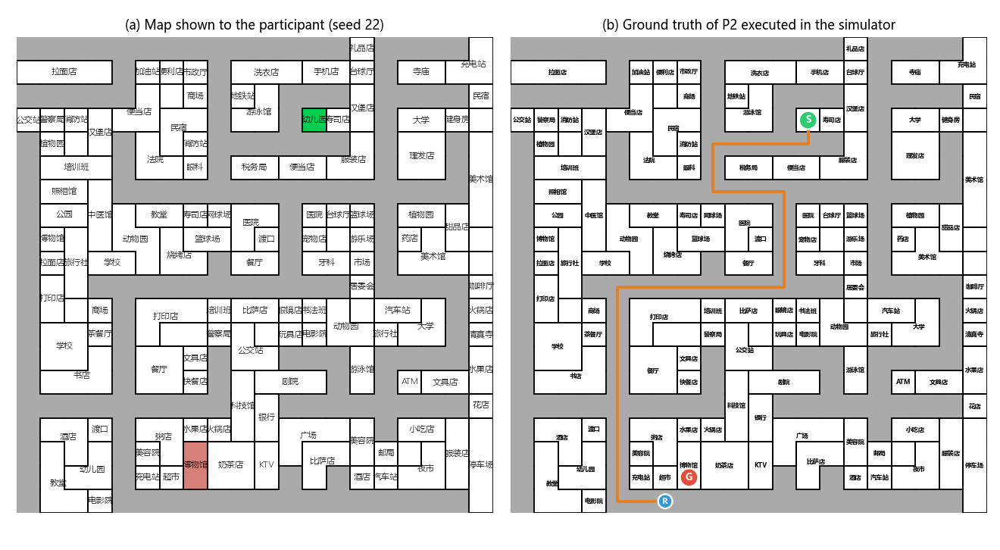

# Chinese Route Instructions → Robot Command Sequences

Corpus, simulator and model outputs for the paper
**"A Model-Class Comparison of Large Language Models for Translating Chinese Route Instructions into Robot Command Sequences"**
(Ruizhe Yang and Yuki Nishimura, *Journal of Sensor and Actuator Networks*, under review).

Six native speakers described routes on procedurally generated town maps.
Each instruction is paired with a ground-truth command sequence that reaches the goal in a grid simulator.
Twelve LLMs were asked to translate the instructions into commands; this repository contains
everything needed to re-score their outputs and reproduce the success rates reported in the paper.

| | |
|---|---|
| Instructions | 212 (train 126 / validation 21 / test 65), split by map |
| Speakers | 6 (P1–P6), native speakers of Chinese |
| Maps | 50, 20 × 20 grid, generated from a seed |
| Models | 12 (3–4B and 7–9B open-weight, cloud API) + 4 LoRA fine-tuned |
| Prompts | 3 (v0: no example, v1: one, v2: three worked examples) |

## Example

*(a) The map shown to the participant (start 幼儿园 Preschool in green, goal 博物馆 Museum in red).
(b) The ground-truth command sequence of P2 executed in the simulator (S = start, G = goal, R = where the robot stopped).*

**Instruction (P2, `map_seed22.png_person2`)** — the model receives the four lines below:

    起点: 幼儿园
    终点: 博物馆
    初始朝向: west
    导航指令: 从幼儿园出发，向西行走至消防站后向南行走，看到网球场后向东行走至便当店的门口。接着向南行走，一直走至眼镜店后向西行走，走到打印店和商场的中间后，接着向南一直走到路的尽头。最后向东行走，就可以到达博物馆

> *From the Preschool go west to the Fire Station, then south; on seeing the Tennis court go east to the
> door of the Bento shop. Then go south to the Optician, then west, to the middle of the Print shop and
> the Mall, then south to the end of the road. Finally go east to reach the Museum.*
> (translation for illustration only; the models received the Chinese text)

**Ground-truth command sequence**

    start('幼儿园', 'west'), detect('消防站'), turn_left(), detect('网球场'), turn_left(),
    detect('便当店'), turn_right(), detect('眼镜店'), turn_right(), detect('打印店'),
    detect('商场'), turn_left(), move_to_end(), turn_left(), stop('博物馆')

| Command | Meaning |
|---|---|
| `start(landmark, heading)` | start next to the landmark, facing north / east / south / west |
| `move_forward()` | move to the next decision point |
| `move_to_end()` | move until the road ends |
| `detect(landmark)` | move until the landmark is adjacent |
| `detect_intersection()` | move to the next intersection |
| `turn_left()` / `turn_right()` | turn 90° |
| `stop(landmark)` | stop; success if the landmark is the goal building |

## Repository layout

    code/
      map_generator.py     generates a map from its seed
      simulator.py         executes a command sequence on a map (permissive / strict mode)
      test_simulator.py    13 unit tests of the transition rules (Supplementary Section S3)
      evaluation.py        scores every model output -> results/evaluation.csv
    corpus/
      gt_train.csv, gt_val.csv, gt_test.csv   instructions and ground-truth commands
      fixed_start_poses.csv                    start cell and heading of every item
    prompt/
      prompt_v0.txt, prompt_v1.txt, prompt_v2.txt   system prompts, byte for byte as used
    output/<tier>/<model>/<model>_<prompt>[_run<n>].csv   raw model outputs (test set, 65 items each)
    docs/
      example_seed22.png   the figure above

The seed of each map is the number in its name (`map_seed22.png` → seed 22) and the `seed` column of the corpus.

## Quick start

Tested with Python 3.11, `pandas`, `numpy` and `matplotlib`:

    pip install -r requirements.txt

    python code/evaluation.py        # ~15 s, writes results/evaluation.csv (3380 rows)
    python code/test_simulator.py    # 13 unit tests
    python code/map_generator.py 22  # draws map_seed22.png

## From `results/evaluation.csv` to the paper

One row per model × prompt × run × test item. Kimi-K2.7-Code and ChatGPT-5.5 were run three times;
the paper reports their mean (each run weighted 1/3).

| Column | Paper |
|---|---|
| `permissive` (path_reach) | Tables 6–8, 12, 13 |
| `strict` | Table 13 |
| `no_turn_advance`, `no_stop_cascade`, `no_revisit_block`, `neighbor4` | Table 14 |
| `parsed`, `executable`, `reached_executable` | Table 15 |
| `no_fallback` | Section 4.5 |

## Corpus files

`gt_*.csv`: `id` (`<map>_<speaker>`), `map_name`, `seed`, `person_id`, `initial_direction`,
`instruction` (the exact text given to the models), `gt_commands` (JSON).
`output/…csv`: `id`, `instruction`, `output` (raw model response).

## Licence

Code (`code/`): MIT. Corpus, prompts and figure (`corpus/`, `prompt/`, `docs/`): CC BY 4.0 (see `LICENSE`).
Outputs of the cloud models are subject to their providers' terms of use (see `NOTICE.md`).

## Citation

    [to be added after acceptance]
